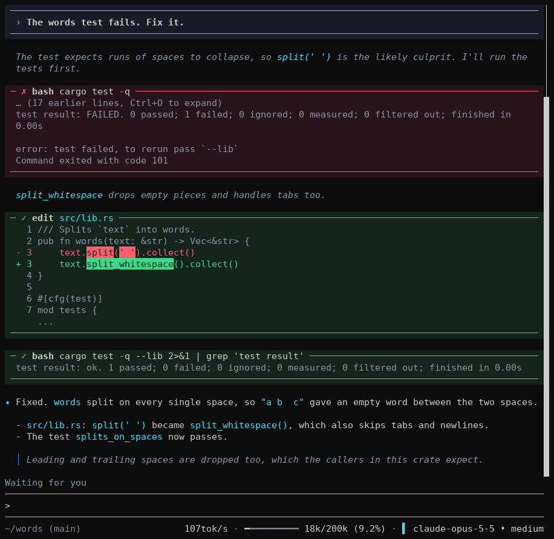
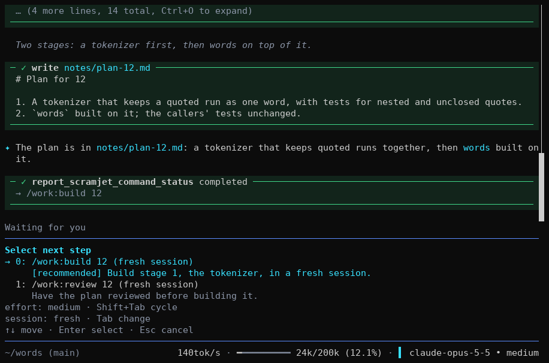
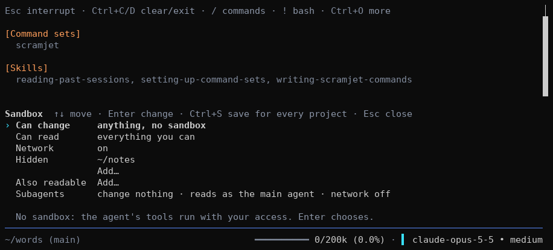

<p align="center">
  
</p>

# Scramjet

A coding agent for the terminal. You say what you want done in your project; it reads the code, runs commands, edits files and tells you what it did, while the screen stays yours: steer it mid-turn, queue the next request, interrupt it, or go back to any earlier point and branch from there. What you find yourself asking for again and again becomes a command, and commands chain into workflows that offer their next step, or take it themselves when you let them.

It works with the models you have: an API key for Anthropic, OpenAI, Google Gemini or OpenRouter, a ChatGPT or GitHub Copilot subscription, a model on your own machine (Ollama, llama.cpp, vLLM, LM Studio), or any server speaking OpenAI's or Anthropic's API. One program, `scramjet`, written in Rust, for Linux, macOS and Windows.

[](LICENSE)

<p align="center">
  
</p>

> **Before you start:** the agent's tool calls run without asking, and its commands run with your own access, outside any sandbox, unless you choose otherwise. `scramjet --ask` asks before each command and each write or edit outside the project. `scramjet -s workspace-write` (or `/sandbox` in a session, or the `sandbox` setting) lets its commands change only the project, and `-s read-only` nothing, on Linux and macOS. [The sandbox](docs/guide/configuration.md#the-sandbox) says what each confines, and [SECURITY.md](SECURITY.md) what the sandbox guarantees and what it does not.

## Install

On Linux and macOS:

```sh
curl -fsSL https://raw.githubusercontent.com/LeanAndMean/scramjet/main/install.sh | sh
```

On Windows, in PowerShell:

```powershell
irm https://raw.githubusercontent.com/LeanAndMean/scramjet/main/install.ps1 | iex
```

Each takes the newest release, checks it and puts it in `~/.local/bin` (on Windows `%LOCALAPPDATA%\Programs\scramjet`). `scramjet update self` takes newer releases. [Installing](docs/guide/install.md) has the options, the archives to install by hand and building from source.

## First steps

In your project's directory:

```sh
scramjet
```

With no model yet, type `/login`: sign in to ChatGPT or GitHub Copilot, enter an API key, or connect a local runtime. Then ask for what you want done, and follow along as it works. `scramjet -c` continues the latest session here, `scramjet -r` chooses one, and `scramjet -p 'Explain src/main.rs'` prints one answer and exits. [Getting started](docs/guide/getting-started.md) walks through a first session, from connecting a model to running a workflow.

## What it does

### A session you can steer

While the agent works, Enter sends what you typed as a steer before its next request, Alt+Enter queues it for when the agent would stop, and Escape interrupts. Escape twice on an empty prompt (or `/tree`) goes back to any earlier point to continue from there, keeping the branch you left; `/resume` reopens an earlier session. `/context` shows what fills the model's window, `/system-prompt` exactly what was sent, and `/usage` what the sessions cost and what is left of your quota where the provider says. The prompt you were typing survives a closed terminal: resuming the session brings it back, with its undo. [Sessions and keys](docs/guide/sessions.md).

### Your models

`/login` signs in to ChatGPT or GitHub Copilot, takes an Anthropic, Google Gemini, OpenAI or OpenRouter API key and lists that provider's models, or connects Ollama, llama.cpp, vLLM or LM Studio on your machine. A server of your own (a company proxy, a hosted gateway) goes in `~/.config/scramjet/models.json`, or comes with its models from a catalog URL. `/model` or Ctrl+P switches the model mid-session, and Shift+Tab the effort. [Providers and logins](docs/guide/providers.md).

### Commands and workflows

<p align="center">
  
</p>

A command is a Markdown file of instructions you would otherwise retype, run as `/set:command`; a command set gathers commands, the agents they hand work to and skills, laid out as a Claude Code plugin is. A command can run another as a subroutine, and declares which steps may follow it: when it finishes you choose one, or with `/autopilot on` the recommended one runs by itself, in a fresh session when the step is large. [Mach 12](https://github.com/LeanAndMean/mach12) is such a set, taking work from a GitHub issue through a plan, reviews and a pull request to a release:

```sh
scramjet install git:github.com/LeanAndMean/mach12
```

The `writing-scramjet-commands` skill, built in, helps the agent write your own. [Command sets](docs/guide/command-sets.md).

### Subagents

The agent hands bounded tasks to subagents, which run in their own context and report back: `scramjet:explore` and `scramjet:general-purpose` are built in, and your own and the command sets' agents are listed beside them. They are read-only unless you let them write, then optionally each in a Git worktree of its own. [Subagents](docs/guide/configuration.md#subagents).

### A sandbox when you want one

<p align="center">
  
</p>

`/sandbox` shows and changes what the agent's commands can change and read and whether they reach the network, for this project or every one. On Linux they run under Bubblewrap, on macOS under Seatbelt; subagents' commands always do (on Windows, at a low integrity level). Credential stores such as `~/.ssh` can be hidden from turns nobody watches, or from every turn. [The sandbox](docs/guide/configuration.md#the-sandbox) and [credentials](docs/guide/configuration.md#credentials).

### MCP servers

Servers over stdio and HTTP, listed in the settings as Claude Code's `.mcp.json` lists them; their tools are found by search, or offered directly when they fit. `/mcp` shows each server and reconnects, enables or disables it. [MCP servers](docs/guide/configuration.md#mcp-servers).

### In an editor

`scramjet acp` speaks the Agent Client Protocol, for editors that host agents: tried in Zed, PyCharm and Toad. [In an editor](docs/guide/acp.md).

### Looks

Light and dark themes that follow the terminal's background, several looks for the conversation and the bottom of the screen, and a theme editor in `/settings`. [Themes](docs/guide/configuration.md#themes-looks-banners-and-bottoms).

## Status

An alpha, nearing its first stable release: a working agent in daily use, still changing quickly.

- **Linux x86_64 and WSL2:** in daily use. Builds run on glibc 2.31 (Ubuntu 20.04) and newer.
- **Windows x86_64:** in daily use by three people, in Windows Terminal and with Git for Windows. Commands run in PowerShell, and in Git for Windows' bash where it is installed. The main agent has no sandbox there, so its commands see everything even where `hideCredentials` asks to hide the stores (it says so); subagents' run at Windows' low integrity level, which keeps them from changing files on local disks but hides nothing.
- **macOS:** used by several people, whose reports have led to fixes. The Seatbelt sandbox passes its checks on GitHub's runners, not yet by hand on a Mac; pasting images from the clipboard has not been tried there.
- **Linux aarch64:** a Raspberry Pi 5 has run the recent releases. Each release's tests pass on GitHub's arm64 runners.
- **Providers:** in daily use through a local proxy speaking OpenAI's Responses and Anthropic's Messages APIs. ChatGPT's and GitHub Copilot's logins, and Chat Completions servers, were checked live when they were built and have been little used since; the API keys of Anthropic, OpenAI, Google Gemini and OpenRouter are new, and have been tried with fake keys only: a report of how they work with a real one is welcome.

Report what works and what does not at [github.com/LeanAndMean/scramjet/issues](https://github.com/LeanAndMean/scramjet/issues), a short "works on my machine" too: `scramjet --version`, the system and terminal, what you did, what you expected and what happened. A session's file (under `~/.local/state/scramjet/sessions/`) shows what was sent and received; it holds the whole conversation and what the agent read, so look through it before attaching it. [docs/TASKS.md](https://github.com/LeanAndMean/scramjet/blob/main/docs/TASKS.md) lists the pending work.

## Coming from Claude Code, Codex or Scramjet 1

- **Claude Code and Codex:** `CLAUDE.md` and `AGENTS.md` are both read, skills from `.agents/skills` as in Codex and from `.claude/skills` as in Claude Code, Claude Code's `.claude/commands` as `/NAME`, `-c` and `-p` work as in Claude Code, MCP servers are listed as in Claude Code's `.mcp.json`, and `--sandbox workspace-write` is Codex's. A command set can stay loadable by Claude Code too.
- **Scramjet 1** (the earlier, TypeScript Scramjet): `scramjet import` copies your settings, providers, logins, key bindings, themes and agents (the first start offers it), and Scramjet 1 keeps working beside it ([how](docs/guide/install.md#beside-scramjet-1)).

[The migration guide](docs/guide/migration.md) has what carries over and what differs.

## Guides

- [Getting started](docs/guide/getting-started.md): a first session, step by step: a model, a task, steering, going back, a workflow.
- [Installing](docs/guide/install.md): the installers, by hand, beside Scramjet 1, from source; where Scramjet keeps its files, and uninstalling.
- [Providers and logins](docs/guide/providers.md): `/login`, `models.json`, model catalogs, proxies, local models.
- [Sessions and keys](docs/guide/sessions.md): the command line, the full screen, session trees, key bindings.
- [Concepts, and a first command set](docs/guide/concepts.md): commands, sets, agents, skills, next steps, autopilot and delegation, then a set of your own built step by step.
- [Command sets](docs/guide/command-sets.md): installing, packages, running commands and their next steps.
- [Configuration](docs/guide/configuration.md): settings, context files, credentials, the sandbox, MCP servers, themes.
- [Settings reference](docs/guide/settings.md): every key of `settings.json`, its values and its default.
- [In an editor (ACP)](docs/guide/acp.md).
- [Coming from Claude Code, Codex or Scramjet 1](docs/guide/migration.md).
- [Troubleshooting](docs/guide/troubleshooting.md): what to do when something fails, and reporting it.
- [Compatibility](docs/guide/compatibility.md): an update keeps reading your settings, sessions and command sets.
- [Privacy](docs/guide/privacy.md): what leaves your machine, to whom, and what stays.
- [Security](SECURITY.md): reporting a vulnerability, and what the sandbox guarantees and what it does not.
- [Terminals](docs/TERMINALS.md): what each terminal does with copying, pasting and keys.
- `scramjet --help`: the options and commands, a line each; `scramjet --help-all` each in full, with the keys and built-in commands; in a session, `/hotkeys` and `/settings`.

## Development

[CONTRIBUTING.md](CONTRIBUTING.md) has the checks and tools, [CLAUDE.md](CLAUDE.md) the development rules, [docs/DESIGN.md](docs/DESIGN.md) the direction, and [CHANGELOG.md](CHANGELOG.md) what changed in each version. [THIRD_PARTY_NOTICES](THIRD_PARTY_NOTICES) inventories the dependencies' licenses. The screenshots come from `scripts/readme-shots.sh`.

## License

Apache-2.0: see [LICENSE](LICENSE).
